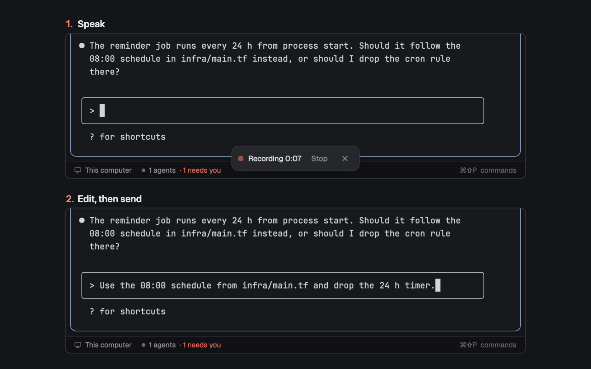

# Corgi · Dictate for Herdr

<h3 align="center">Talk to your agents instead of typing. Press a key, speak, press it again: the text is transcribed on your Mac and lands at your cursor, ready to edit before you send it.</h3>

<p align="center"></p>

<p align="center"><sub>✓&nbsp;Free,&nbsp;MIT &nbsp;·&nbsp; ✓&nbsp;Runs&nbsp;locally &nbsp;·&nbsp; ✓&nbsp;herdr-app&nbsp;0.1.14+</sub></p>

Part of [Corgi](https://github.com/saefty/herdr-corgi), a set of Herdr mods that plug into each other.

Speak instead of typing, in any terminal in Herdr. Press ⌘⇧M, talk, press ⌘⇧M again: the text is transcribed on
your Mac and pasted where your cursor is, without pressing Enter. You read it, fix a word, and send it yourself.

macOS only. Nothing leaves the machine: ffmpeg records, [parakeet-mlx](https://github.com/senstella/parakeet-mlx)
transcribes on Apple Silicon, and the model detects the language by itself.

## Use cases

- **A long prompt for an agent.** Explain the bug the way you would to a colleague; the words land in Claude Code's
  input, ready to edit. Nothing is submitted until you press Enter.
- **Answering an agent from the chat bar.** With the [chat bar](https://github.com/saefty/herdr-corgi-chatbar) installed,
  each reply field has a mic: click, speak, click. The text is appended to that bubble's field.
- **A shell command you can say faster than type.** It lands on the prompt line; you check it before running it.
- **Your own mod.** It can ask for a recording and get the text back instead of having it typed.

## Features

- One key to start and stop (`dictate.toggle`, ⌘⇧M in the sample `keys.json`). While recording a small float at the
  bottom shows a pulsing dot and the time, with Stop and ✕ (cancel, nothing typed). Then "Transcribing…", then it
  disappears.
- Fast after you stop: a worker loads the model while you speak and warms it up on a second of silence, so only the
  transcription itself is left.
- Pastes into the terminal that has focus when the text is ready, as a paste (bracketed), never with Enter. Line
  breaks are removed. With no terminal focused, the text stays on the clipboard and a toast says so. Your previous
  clipboard text is put back after the paste.
- Nothing stays running: the worker exits after one transcription (or after a timeout), recording stops at
  `maxSeconds`, and cancel or closing Herdr stops both.
- Missing ffmpeg or parakeet-mlx: a toast (and the chat bar's mic tooltip) says what to install. It never installs
  anything itself.

## Requirements

| What | Needed for | Install |
|---|---|---|
| macOS on Apple Silicon | everything | |
| Herdr | everything | |
| `python3` | the recorder and worker scripts (standard library only) | ships with the Xcode command line tools |
| ffmpeg | recording (avfoundation) | `brew install ffmpeg` |
| parakeet-mlx | transcription | `uv tool install parakeet-mlx` |

Herdr needs microphone access the first time (System Settings → Privacy & Security → Microphone).

## Install in three steps

<table>
<tr>
<td align="center" valign="top" width="33%"><h3>1</h3><b>Add the mod</b><br /><sub>With <a href="https://github.com/saefty/herdr-corgi">Corgi</a>: <code>corgi enable dictate</code>. By hand: copy <code>mods/dictate</code> to <code>~/.config/herdr-app/mods/</code>.</sub></td>
<td align="center" valign="top" width="33%"><h3>2</h3><b>Add the key and the float</b><br /><sub>Corgi asks before it adds ⌘⇧M. By hand: merge <code>keys.json</code> into <code>~/.config/herdr-app/keys.json</code>. Either way, add the floating block below to your layouts.</sub></td>
<td align="center" valign="top" width="33%"><h3>3</h3><b>Check it</b><br /><sub>Corgi does this for you. By hand: <code>herdr-app check ~/.config/herdr-app/mods/dictate</code>. Then press ⌘⇧M and speak.</sub></td>
</tr>
</table>

Or tell your agent: `Read ~/.config/herdr-app/AGENTS.md, then add this mod: https://github.com/saefty/herdr-corgi-dictate/tree/main`

By hand, step by step:

1. Copy `mods/dictate` to `~/.config/herdr-app/mods/`.
2. Add a floating block to each layout you use (`~/.config/herdr-app/layouts/<name>.json`), on the root node or the
   node that holds your terminals. The key reaches dictate only in layouts that have it:

   ```json
   "floating": [
     { "id": "dictate", "content": { "mod": "dictate" }, "edge": "bottom", "align": "center" }
   ]
   ```

3. Merge `keys.json` into `~/.config/herdr-app/keys.json` (`"cmd-shift-m": "dictate.toggle"` under `global`), or
   pick another free key.
4. Optional: `~/.config/herdr-app/dictate.config.json`:

   ```json
   { "model": "mlx-community/parakeet-tdt-0.6b-v3", "device": "0", "maxSeconds": 300 }
   ```

   `model` is any parakeet-mlx model on Hugging Face (default as above; the first use downloads it), `device` the
   avfoundation audio input (`ffmpeg -f avfoundation -list_devices true -i ""` lists them), `maxSeconds` the
   longest recording.
5. Run `herdr-app check ~/.config/herdr-app/mods/dictate`.

It runs `python3 mods/dictate/voice.py`, which starts ffmpeg and parakeet-mlx's own python, and writes the recording
and the transcript to a folder in your temp directory (deleted after use). It reads the clipboard and runs Herdr's
`terminal.paste`. It makes no network calls, except parakeet-mlx downloading a model it doesn't have yet.

## Customize

Without touching code:

- **Model, microphone and longest recording:** `model`, `device` and `maxSeconds` in `dictate.config.json`
  (step 4 above).
- **The key:** ⌘⇧M comes from `keys.json`. Bind `dictate.toggle` to any free key instead.
- **Where the float shows:** `edge` and `align` in the floating block, and only in the layouts you add it to.
- **A mic in the chat bar's reply fields:** install the [chat bar](https://github.com/saefty/herdr-corgi-chatbar).

Changed the code itself? Your edits survive `corgi update`: Corgi merges your version, the old release and the new
one. `corgi diff dictate` shows what you changed, and `corgi resolve dictate` helps when an update and your edit
touch the same lines.

## Tests

`node --test mods/dictate/test_route.mjs`, and one real transcription without the mic:

```sh
say -o /tmp/hello.aiff "Hello world" && ffmpeg -y -i /tmp/hello.aiff -ac 1 -ar 16000 /tmp/hello.wav
python3 mods/dictate/voice.py transcribe /tmp/hello.wav ~/.config/herdr-app/dictate.config.json
```

## For mod authors

How to ask for a recording from your own mod and get the text back: [PROVIDERS.md](mods/dictate/PROVIDERS.md).

## License

MIT
